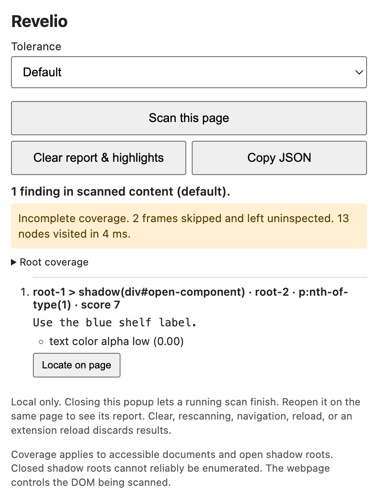

# Revelio

Revelio is a Chrome extension for inspecting potentially hidden webpage text.

## Overview

Web reviewers and people checking pages used by AI assistants can scan the active tab and inspect text that might be hard to see. Revelio shows the evidence behind each finding so you can decide whether the text is legitimate, suspicious, or worth a closer look.

## Installation

Install the published `v1.0.0` build from the [Chrome Web Store](https://chromewebstore.google.com/detail/revelio/hdcjpjjfangdnigmhdnnmhndanhejeem), or follow the setup below to try the current source.



## Features

- Scan on demand with four tolerance levels and cancel while the scan is running.
- Inspect text snippets and evidence, then locate and highlight findings on the page.
- Review coverage for accessible frames and open shadow roots, including skipped roots and work-limit warnings.
- Copy the retained report as JSON or clear the report and highlights from the popup.

## How it works

The popup starts a scan through Chrome's `activeTab` and `scripting` permissions. An isolated content script inspects DOM text and computed styles in small batches, yielding to other browser work and limiting traversal time, nodes, roots, and text. It ranks results by evidence and retains the strongest matches. The popup validates document and scan identifiers and renders snippets as literal text.

## Tech stack

- Chrome Manifest V3 provides the popup, per-tab access, and content-script messaging.
- JavaScript and browser DOM/CSS APIs handle inspection and ranking. HTML/CSS renders the report.
- Node.js and Playwright run the package, unit, and Chromium checks.

## Getting started

Chrome is required. Loading the unpacked extension requires no build or npm install.

```sh
git clone https://github.com/ant0n-grachev/Revelio.git
cd Revelio
```

1. Open `chrome://extensions`, enable **Developer mode**, and select **Load unpacked**. Choose the cloned `Revelio` folder.
2. Open a regular webpage, click Revelio in the toolbar, and select **Scan this page**.
3. Review the report and coverage warning. Use **Locate on page**, **Copy JSON**, or **Clear report & highlights** as needed.

## Configuration

Start with **Default**. **Precise** asks for stronger evidence, **Sweep** is broader, and **Everything** shows supported candidates within the scan and report limits. The tolerance preference is stored locally. Reports stay in document memory until cleared, replaced, or the page navigates or reloads. Export happens only on request. No backend, accounts, credentials, or AI service are required. [Scanning and privacy details](docs/scanning.md) · [Published privacy policy](https://anton.grachev.us/Revelio/privacy.html)

## Testing

Use Node.js 22+ and a desktop display. Browser checks include both fixtures and the actual unpacked extension, with the real toolbar action and messaging path.

```sh
npm ci
npx playwright install chromium
npm test
```

On headless Linux, run `npx playwright install --with-deps chromium` followed by `xvfb-run -a npm test`. See the [verification notes](docs/verification.md) for measured results and what was exercised.

## Limitations

Findings are heuristics and can include legitimate accessibility text or hidden UI. A scan with zero findings can have incomplete coverage. Closed shadow roots, restricted pages, inaccessible frames, and text outside the supported DOM/CSS surfaces can escape inspection. A changing page can need a fresh scan. Revelio is for review and does not block prompt injection or certify page safety. [Coverage details and research](docs/scanning.md#research)

## Project structure

| Files | Role |
| --- | --- |
| `content.js`, `detection.js`, `retention.js` | Scan lifecycle, evidence, and ranking |
| `popup.html`, `popup.js`, `protocol.js` | Popup controls, rendering, and message validation |
| `tests/`, `scripts/check.cjs` | Unit and browser tests, package checks, and version consistency |

## Versioning and credits

This source prepares the unreleased `v1.0.1` patch. The application version lives in `manifest.json` and is mirrored in `package.json` and `package-lock.json`. Versions follow [Semantic Versioning](https://semver.org/), with `vX.Y.Z` used in release labels. See the [changelog](CHANGELOG.md).

Created by Anton Grachev and distributed under the [MIT license](LICENSE). Use [GitHub Issues](https://github.com/ant0n-grachev/Revelio/issues) to report a bug with a minimal, non-sensitive example.
